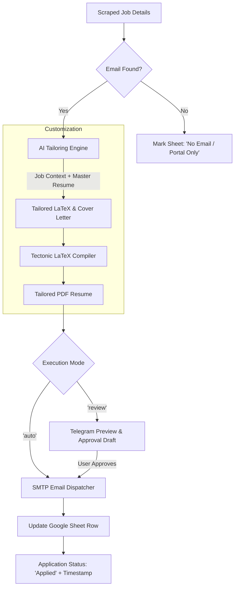

# Implementation Plan: Automated Tailored Job Application Pipeline

This document outlines the step-by-step engineering plan to extend `job_scraper_project` to automatically generate customized resumes, dispatch email applications with tailored cover letters, and track application statuses directly in Google Sheets / Excel.

---

## 1. Executive Architecture Overview

---

## 2. Master CV Analysis & Strategy

The master CV is located at `master_resume.tex`:
- **Candidate:** Md Moniruzzaman (Senior Mobile Application Engineer)
- **Primary Strengths:** 7+ years experience, Dual-Platform Native (Kotlin/Android, Swift/iOS) + Cross-Platform (Flutter, React Native), FinTech / PCI-DSS compliance, system design.
- **Compilation Engine:** `tectonic.exe` is already installed and verified on the local machine (`C:\Users\mzama\AppData\Local\tectonic\tectonic.exe`), compiling clean PDFs in ~1-2 seconds with zero external package installations required.

### Sections to Dynamically Tailor
To maximize ATS match score while preventing LaTeX syntax errors:
1. **Professional Summary:** Tailored 3-4 sentence summary emphasizing the specific stack requested in the job (e.g., Lead Android vs. Full-stack Mobile vs. React Native vs. Flutter).
2. **Core Competencies:** Dynamic reordering of the top 8 competencies matching keywords in the job description.
3. **Technical Skills Order:** Putting the job's target language/framework first in the skill breakdown.
4. **Key Projects & Experience Focus:** Subtle highlighting of the most relevant apps (e.g., DGePay for FinTech, UNICEF for Offline-first/HealthTech, Visual Compliance for Enterprise).

---

## 3. Implementation Phases & Modules

### Phase 1: Storage & LaTeX Templating (`templates/`)
- **Deliverable:** `templates/resume_template.tex`
- Extract parameterized tokens or Jinja2 markers into the resume template:
  - `{{ PROFESSIONAL_SUMMARY }}`
  - `{{ CORE_COMPETENCIES }}`
  - `{{ TECHNICAL_SKILLS }}`
- Provide a safe LaTeX escaping utility (`latex_escape(text)`) to prevent compilation breaks caused by special characters (`&`, `%`, `$`, `#`, `_`, `{`, `}`).

---

### Phase 2: Email Extraction & Enrichment Module (`handlers/email_extractor.py`)
- **Deliverable:** Extract recipient emails from:
  1. Job descriptions (regex pattern: `[a-zA-Z0-9._%+-]+@[a-zA-Z0-9.-]+\.[a-zA-Z]{2,}`).
  2. Domain heuristics (e.g., if company is `example.com`, check for explicit `careers@example.com` or `jobs@example.com` in listing text).
- Classify jobs into:
  - `EMAIL_DIRECT`: Has a verified application email.
  - `ATS_PORTAL`: Standard Greenhouse, Lever, Workday, Ashby link requiring web forms.

---

### Phase 3: AI Tailoring Engine (`ai/tailor.py`)
- **Deliverable:** AI agent supporting Gemini API (and OpenAI API fallback) to produce:
  1. **Tailored LaTeX Segments:** Generates compliant LaTeX syntax replacing the summary and skills.
  2. **Personalized Email Pitch:**
     - **Subject Line:** `Application for {job_title} - Md Moniruzzaman`
     - **Body:** Engaging 3-paragraph email referencing specific company requirements and linking relevant live store apps (DGePay, UNICEF, etc.).
- Prompts will enforce strict JSON output schema containing:
  - `latex_summary`: Validated LaTeX string.
  - `email_subject`: Short, professional subject.
  - `email_body_text`: Plain text email.
  - `email_body_html`: Styled HTML email with clickable portfolio links.

---

### Phase 4: PDF Compiler Service (`services/compiler.py`)
- **Deliverable:** Lightweight Python wrapper around `tectonic.exe`:
  - Input: Tailored `.tex` string and target output path `generated_cvs/CV_Moniruzzaman_{Company}_{JobId}.pdf`.
  - Compiles headless without cluttering root directory.
  - Handles timeout and compilation error fallbacks (reverting to baseline `master_resume.pdf` if compilation fails).

---

### Phase 5: Email Dispatch Router (`routers/email_router.py`)
- **Deliverable:** SMTP client supporting standard Gmail App Passwords, Outlook, or transactional providers (Resend / SendGrid).
- **Features:**
  - MIME multipart (HTML body + Plaintext fallback).
  - PDF CV attachment with clean naming (`Md_Moniruzzaman_Resume_{Company}.pdf`).
  - Rate limiting & backoff safeguards (e.g. max 5 emails/minute, randomized delays).
  - Safety check: `DRY_RUN` flag in `.env` to test without actually sending.

---

### Phase 6: Sheet & State Schema Extension (`routers/sheets.py`)
- **Deliverable:** Extend existing Google Sheets headers in `routers/sheets.py`:
  - **Existing:** `["Company", "Title", "Location", "URL", "Actual Post Date", "Date Found", "Worldwide"]`
  - **New Columns Added:**
    - `Contact Email`: Target recipient.
    - `Application Status`: `Applied`, `Drafted (Awaiting Review)`, `No Email (Apply via Link)`, `Failed`.
    - `Applied Date`: Timestamp in 12-hour AM/PM BST format.
    - `Resume Version`: Link or filename of the tailored CV.
- Add `update_job_status(job_url, status, email, timestamp)` to `GoogleSheetsRouter`.

---

### Phase 7: Pipeline Integration & Approval Modes (`run_pipeline.py`)
- **Deliverable:** Integration into the main execution cycle:
  - Configuration in `.env`:
    - `AUTO_APPLY_ENABLED=True`
    - `AUTO_APPLY_MODE=review` (Options: `review`, `auto`, `dry_run`)
    - `SMTP_USER=contact@moniruz.dev` (or Gmail address)
    - `SMTP_PASSWORD=...`
    - `SMTP_HOST=smtp.gmail.com`
    - `SMTP_PORT=587`
    - `GEMINI_API_KEY=...`
  - **Review Mode Flow:** When a new job with an email is found, compile the CV and send a Telegram message with:
    - Job Title & Company
    - Recipient email & generated email draft
    - Attached generated PDF
    - Command or approval trigger to send.
